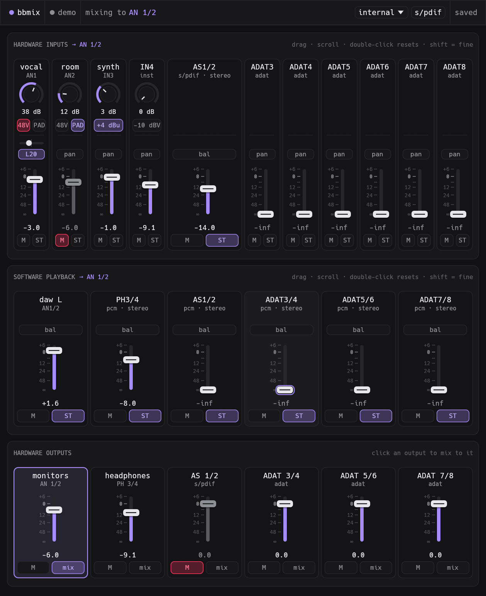

# bbmix

A modern mixer for the **RME Babyface Pro / Pro FS** on Linux, in the same look as
[weather_shark](https://github.com/TukeCS/weather_shark) (dark, monospace, violet accent).

RME never made Linux drivers or a Linux TotalMix, but the kernel's `snd-usb-audio`
driver exposes the Babyface's hardware mixer as ALSA controls. bbmix is a front end for those.



## Features

- **TotalMix-style workflow.** Three rows: hardware inputs, software playback and hardware
  outputs. Click an output (or press `1`–`6`) and the two rows above show and edit what's
  mixed into it. Each output pair has its own volume fader and mute.
- **Every input and playback channel** routed to any output pair (AN 1/2, PH 3/4, AS 1/2, ADAT …),
  with a fader (−∞ to +6 dB) and mute per channel.
- **Mono and stereo like TotalMix.** Channels are mono and centred by default, so you hear them
  in both ears (mics included). Click **pan** on a strip to pan it. Click **ST** to link a pair
  (AN1+AN2, IN3+IN4 …) into one stereo strip: left → left ear, right → right ear, one fader,
  and **bal** for balance. Software playback starts as stereo pairs.
- **Preamp gain** for AN1/AN2 (mic, 0–65 dB) and IN3/IN4 (instrument, 0–9 dB), plus 48V,
  PAD and −10 dBV / +4 dBu. These need the gain controls added in Linux 6.4.
- **Your mix is remembered.** Everything is saved to `~/.config/bbmix/state.json` as you go
  and written back onto the interface every time it connects (boot, replug, power-cycle).
  You can even set things up while it's unplugged.
- Clock source (AutoSync / Internal) and S/PDIF options.
- Rename channels (double-click a name), so `AN1` can say `vocal`.
- Stays in sync with changes made from `alsamixer` or `alsactl`.

## Controls

| | |
|---|---|
| drag | move a fader / knob / pan |
| shift + drag | fine adjust |
| scroll wheel | 0.5 dB per notch on faders, 1 step on gain knobs |
| double-click | reset (fader → 0 dB, pan → centre, gain → 0) |
| double-click a name | rename the channel |
| click an output | mix to that output (also `1` – `6`) |

## Build & install

Needs Rust and the ALSA development files (`alsa-lib` / `libasound2-dev`).

```sh
cargo install --path .
cp misc/bbmix.desktop ~/.local/share/applications/
```

Other options:

```sh
bbmix --demo                  # try it without the interface (never touches hardware)
bbmix --screenshot out.png    # render one frame and quit
BBMIX_STATE=/path/state.json bbmix   # use a different state file
```

## Why does it exist?

Yes, this was made with Claude, but only the base. I didn't want to spend too much time
making my audio interface work, since RME didn't make Linux drivers. Claude was just used
for the base, inspired by [bbfpromix](https://github.com/MrBollie/bbfpromix), which has been
discontinued. The rest is maintained by ME!

## License

MIT, see [LICENSE](LICENSE).
